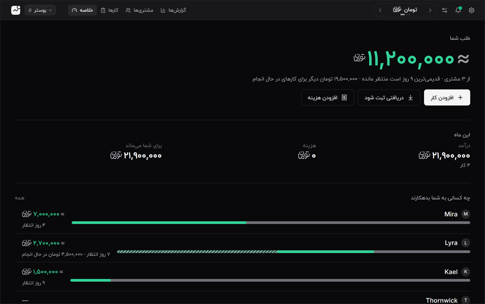
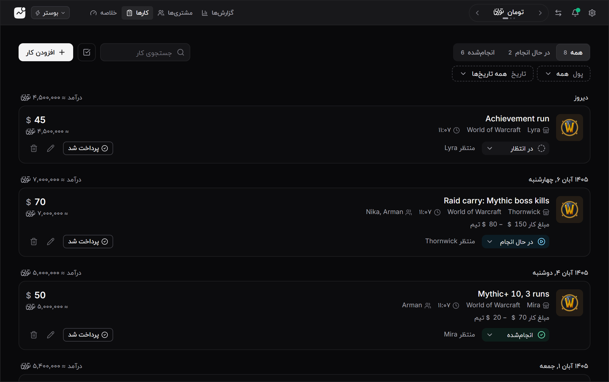
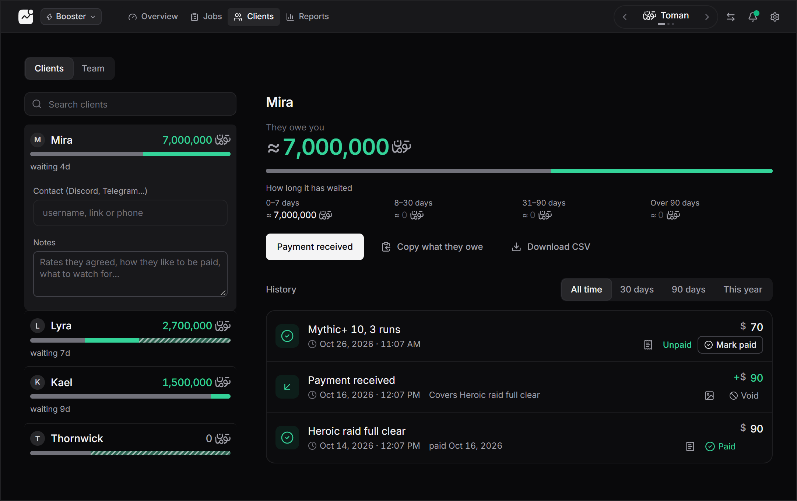
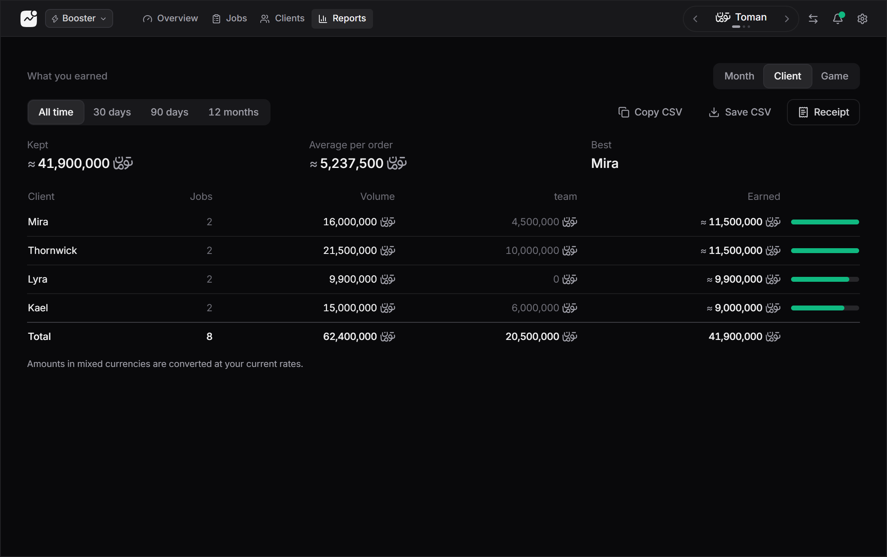
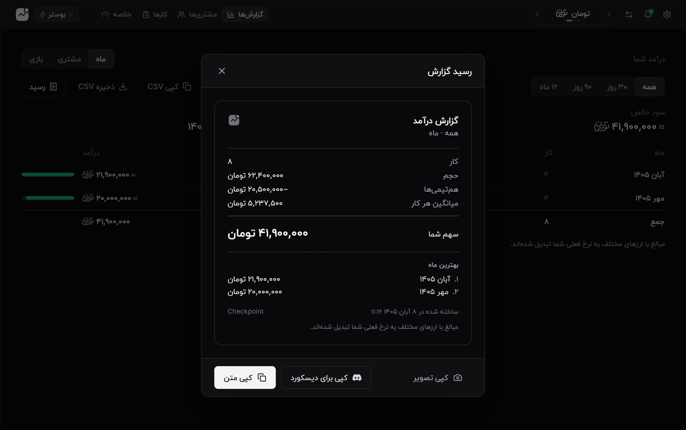
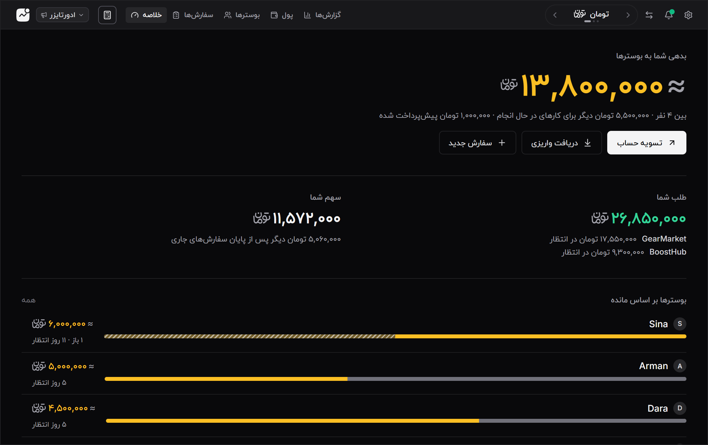
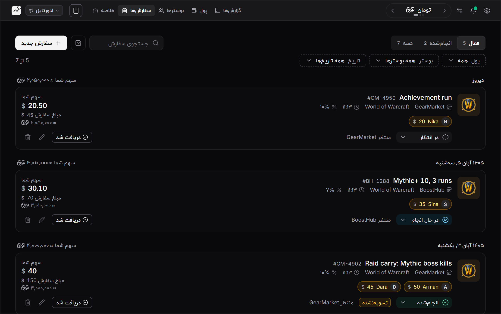
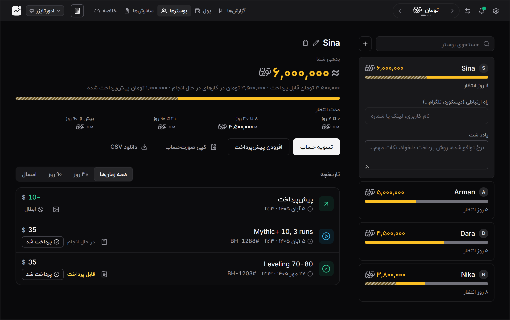
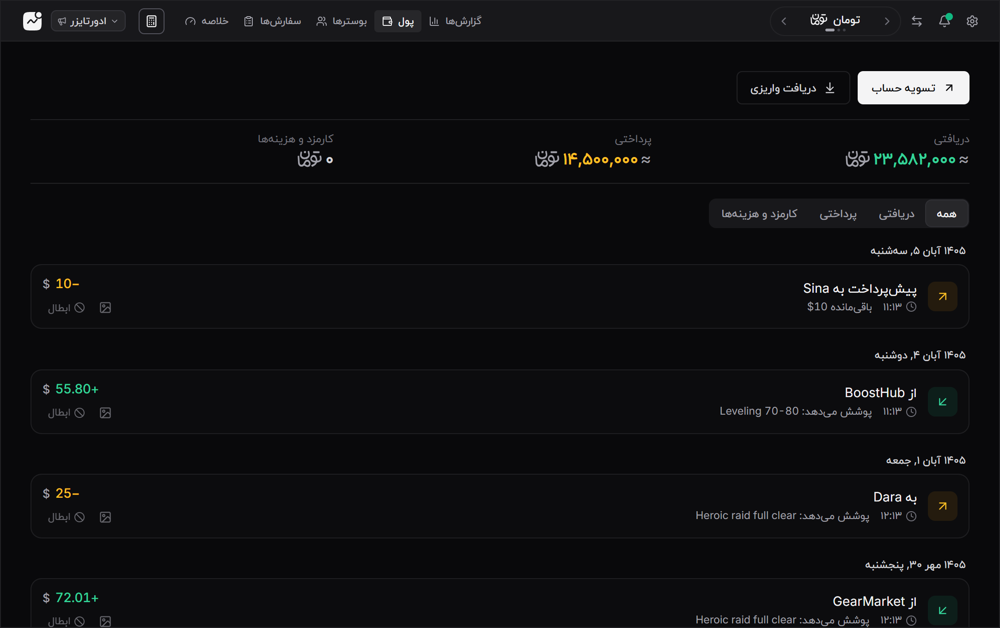

# CHECKPOINT // Nodra Freelance & Gaming Ledger

<p align="center">
  <a href="docs/screenshots/hero-dark.png">
    <picture>
      <source media="(prefers-color-scheme: light)" srcset="docs/screenshots/hero-light.png">
      
    </picture>
  </a>
  <br />
  <sub>تم تیره یا روشن، هر کدام که مرورگر شما روی آن است ☾ ☀</sub>
</p>

<p align="center">
  
  
  
  
  
  
  
</p>

<p align="center">
  <a href="https://github.com/vltmk/Checkpoint/releases">
    
  </a>
</p>

---

## چک‌پوینت: دفتر حساب بوست و فریلنسینگ گیمینگ

چک‌پوینت یک نرم‌افزار دسکتاپ سبک و **کاملاً آفلاین** است که برای ثبت کارها، دنبال کردن پول و صدور رسید ساخته شده. همه‌چیز روی کامپیوتر خودتان می‌ماند و برای کار کردن به اینترنت یا حساب کاربری نیاز ندارد.

> **📥 دانلود برای ویندوز:** از صفحه [Releases](https://github.com/vltmk/Checkpoint/releases) در بخش **Assets** فایل نصبی (`.exe` یا `.msi`) را دانلود و نصب کنید. نسخه‌های بعدی را خود برنامه پیدا می‌کند و از داخل همان‌جا نصب می‌شوند.

---

## 🖼️ نگاهی به برنامه

هر تصویر را بزنید تا بزرگ باز شود. داده‌ی این تصاویر نمونه است. زبان برنامه فارسی و انگلیسی است و دو تصویر زیر برای نمونه انگلیسی گرفته شده‌اند.

<table align="center">
  <tr>
    <td colspan="4" align="center"><b>⚡ پروفایل بوستر</b> · طلب شما از مشتری‌ها</td>
  </tr>
  <tr>
    <td align="center"><a href="docs/screenshots/booster-jobs.png"></a><br /><sub>کارها</sub></td>
    <td align="center"><a href="docs/screenshots/booster-clients-en.png"></a><br /><sub>مشتری‌ها (EN)</sub></td>
    <td align="center"><a href="docs/screenshots/booster-reports-en.png"></a><br /><sub>گزارش‌ها (EN)</sub></td>
    <td align="center"><a href="docs/screenshots/booster-receipt.png"></a><br /><sub>رسید و دیسکورد</sub></td>
  </tr>
  <tr>
    <td colspan="4" align="center"><b>📢 پروفایل ادورتایزر</b> · بدهی شما به بوسترها</td>
  </tr>
  <tr>
    <td align="center"><a href="docs/screenshots/advertiser-overview.png"></a><br /><sub>خلاصه</sub></td>
    <td align="center"><a href="docs/screenshots/advertiser-orders.png"></a><br /><sub>سفارش‌ها</sub></td>
    <td align="center"><a href="docs/screenshots/advertiser-boosters.png"></a><br /><sub>بوسترها</sub></td>
    <td align="center"><a href="docs/screenshots/advertiser-money.png"></a><br /><sub>پول</sub></td>
  </tr>
</table>

---

# ✨ قابلیت‌های اصلی

### ۱. 🔒 آفلاین و خصوصی
- اطلاعات، مبلغ‌ها، یادداشت‌ها و اسکرین‌شات‌های شما **فقط روی کامپیوتر خودتان** ذخیره می‌شوند (پایگاه‌داده‌ی SQLite محلی).
- بررسی نسخه‌ی جدید و اعلان‌ها در پس‌زمینه انجام می‌شود. اگر اینترنت نباشد، برنامه همان‌طور کار می‌کند.

---

### ۲. 🎭 دو پروفایل، هرکدام با نگاه خودش
یک کلیک (یا `Ctrl` + `Shift` + `P`) بین دو پروفایل جابه‌جا می‌شوید. دیتابیس هر پروفایل جداست.

| | ⚡ بوستر | 📢 ادورتایزر |
| :--- | :--- | :--- |
| عدد اصلی | **طلب شما** از مشتری‌ها | **بدهی شما** به بوسترها |
| صفحه‌ها | خلاصه، کارها، مشتری‌ها، گزارش‌ها | خلاصه، سفارش‌ها، بوسترها، پول، گزارش‌ها |
| تقسیم سهم با هم‌تیمی‌ها | اختیاری. یک کار ساده فقط سه فیلد دارد | سهم هر بوستر روی هر سفارش |
| کارمزد پلتفرم | اختیاری | روی هر سفارش و برای هر پلتفرم |

---

### ۳. 📢 ویژه‌ی ادورتایزرها
- **سفارش از پلتفرم تا بوستر:** مبلغ سفارش، کارمزد پلتفرم و سهم هر بوستر را ثبت کنید. سود شما خودکار حساب می‌شود: `مبلغ − کارمزد − سهم بوسترها`.
- **مانده‌ی هر بوستر:** ببینید به هر نفر چقدر بدهکارید، چقدر پیش‌پرداخت داده‌اید و چقدر از کارهای در حال انجام در راه است.
- **تسویه‌ی حساب:** پرداخت به بوستر و واریزی پلتفرم را ثبت کنید و مشخص کنید هر پرداخت کدام سفارش یا سهم را می‌بندد.
- **کارمزد برداشت:** اگر پلتفرم از واریزی کارمزد برمی‌دارد، همان‌جا ثبت می‌شود و روی سفارش‌های همان واریزی پخش می‌شود.
- **هشدار پول:** اگر پیش از پرداخت مشتری به بوستر پول داده‌اید، یا مشتری پرداخته و بوسترها هنوز نه، در بخش «نیاز به توجه» نشان داده می‌شود.
- **ماشین حساب سفارش:** با کلید `Q`.

---

### ۴. 🪙 تومان، دلار، یورو و گلد
- پشتیبانی از **تومان، دلار، یورو و گلد** و تبدیل دوطرفه بین آن‌ها. نرخ گلد را هم برای کلاسیک (هر ۱ گلد) و هم ریتیل (هر ۱۰۰۰ گلد) می‌توانید تنظیم کنید.
- **هر سفارش و هر پرداخت نرخ همان روز خودش را نگه می‌دارد.** تغییر نرخ، پولی را که قبلاً درآورده‌اید جابه‌جا نمی‌کند.
- با `T` یا دکمه‌ی بالای صفحه، ارز نمایش مبلغ‌ها را عوض کنید.

---

### ۵. 📋 اسکرین‌شات به‌عنوان مدرک کار
- اسکرین‌شات بگیرید (`Win` + `Shift` + `S`) و داخل پنجره‌ی ثبت `Ctrl` + `V` بزنید، یا فایل را بکشید و رها کنید.
- مشاهده‌ی تصویر در اندازه‌ی کامل و نگه‌داری کنار سفارش یا پرداخت.

---

### ۶. 🧾 رسید و خروجی دیسکورد
- رسید مرتب با عنوان، مبلغ، سهم‌ها و گزارش‌ها.
- **کپی برای دیسکورد** (Markdown آماده)، **کپی متن** و **کپی تصویر** رسید، با یک کلیک.

---

### ۷. 📊 گزارش‌ها
- درآمد به تفکیک **ماه، مشتری و بازی**، در بازه‌ی همه / ۳۰ روز / ۹۰ روز / ۱۲ ماه.
- خروجی CSV (کپی یا ذخیره) و رسید گزارش.
- ورود از جدول: جدول خود را از گوگل‌شیت یا اکسل کپی و داخل برنامه جای‌گذاری کنید.

---

## 💾 پشتیبان‌گیری و بازیابی

چون چک‌پوینت آفلاین است، فایل‌های داده دست خودتان است.

1. روی آیکون **Settings (چرخ‌دنده)** بالای صفحه بزنید.
2. **پشتیبان کامل JSON** (`Alt` + `B`) همه‌چیز را با اسکرین‌شات‌ها ذخیره می‌کند. آن را جای امن نگه دارید.
3. **خروجی CSV** (`Alt` + `E`) برای حساب‌کتاب شخصی.
4. برای بازگردانی، از همان بخش فایل `.json` پشتیبان را انتخاب کنید. ورودی از فایل، پیش از نوشتن بررسی و پاک‌سازی می‌شود.
5. **اسنپ‌شات‌های خودکار:** برنامه پیش از تغییرهای مهم یک نقطه‌ی بازیابی می‌سازد. اگر چیزی را اشتباهی پاک کردید، از لیست اسنپ‌شات‌ها برگردید.

---

## ⌨️ کلیدهای میانبر

| Shortcut | کار |
| :--- | :--- |
| <kbd>?</kbd> | راهنمای کلیدها |
| <kbd>N</kbd> | افزودن کار (بوستر) یا سفارش جدید (ادورتایزر) |
| <kbd>1</kbd> – <kbd>4</kbd> | بوستر: خلاصه، کارها، مشتری‌ها، گزارش‌ها |
| <kbd>1</kbd> – <kbd>5</kbd> | ادورتایزر: خلاصه، سفارش‌ها، بوسترها، پول، گزارش‌ها |
| <kbd>T</kbd> | تغییر ارز نمایش |
| <kbd>Q</kbd> | ماشین حساب سفارش (ادورتایزر) |
| <kbd>/</kbd> | رفتن به کادر جستجو |
| <kbd>S</kbd> | حالت انتخاب چندتایی |
| <kbd>Ctrl</kbd>+<kbd>Shift</kbd>+<kbd>P</kbd> | جابه‌جایی بین پروفایل‌ها |
| <kbd>Ctrl</kbd>+<kbd>V</kbd> | چسباندن اسکرین‌شات |
| <kbd>Alt</kbd>+<kbd>E</kbd> | خروجی CSV |
| <kbd>Alt</kbd>+<kbd>B</kbd> | پشتیبان کامل JSON |
| <kbd>Esc</kbd> | بستن پنجره یا لغو انتخاب |

---

## Getting Started

```bash
# 1. Install dependencies
npm install

# 2. Run the desktop app in development (needs Rust + Tauri prerequisites)
npm run desktop:dev

# 3. Build the installer
npm run desktop:build

# Run the test suite
npm run test
```

`npm run dev` فقط رابط کاربری را در مرورگر اجرا می‌کند (برای توسعه و تست). محصول نهایی یک برنامه‌ی دسکتاپ است و ذخیره‌سازی اصلی آن SQLite است.

---

## Developer Guide

For code conventions, the v2 ledger model, and the manual git/release workflow, see [`AGENTS.md`](./AGENTS.md).
